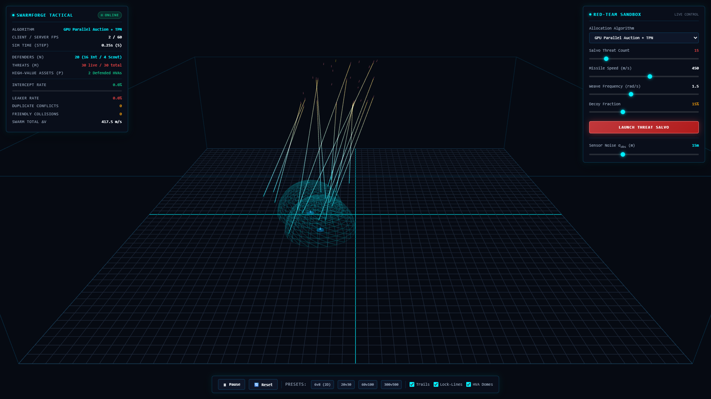
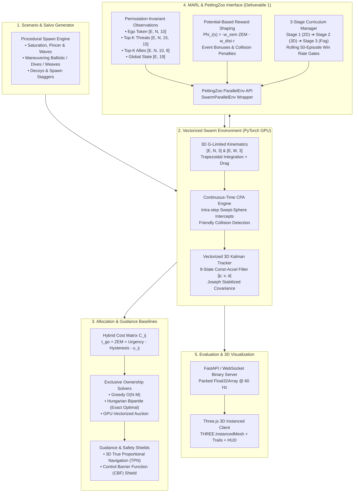
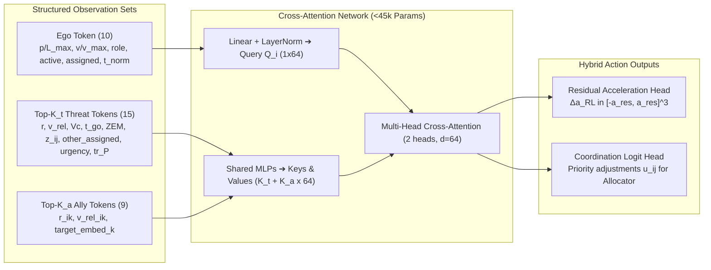
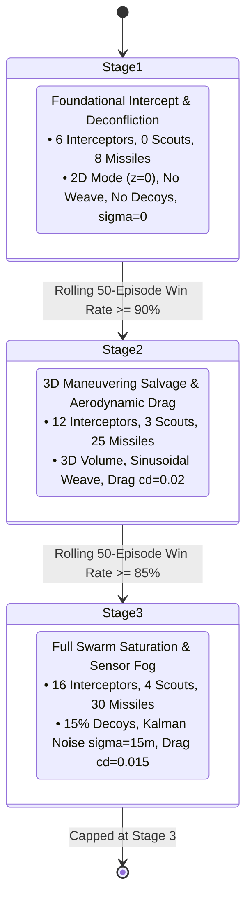
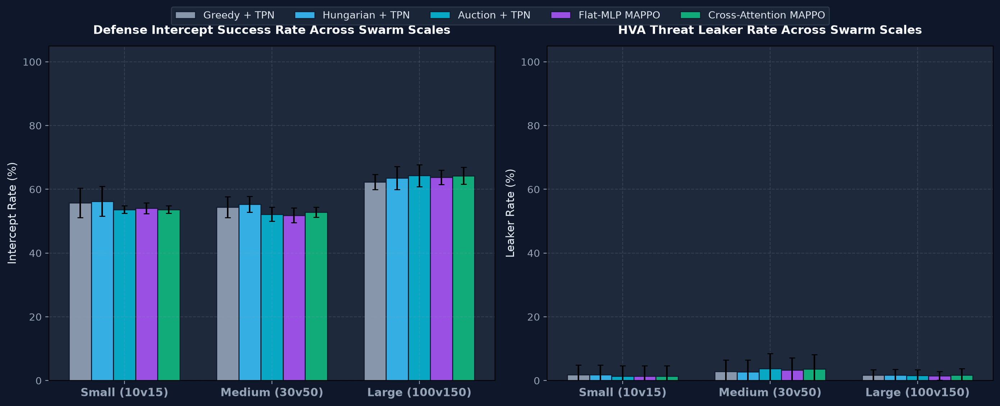
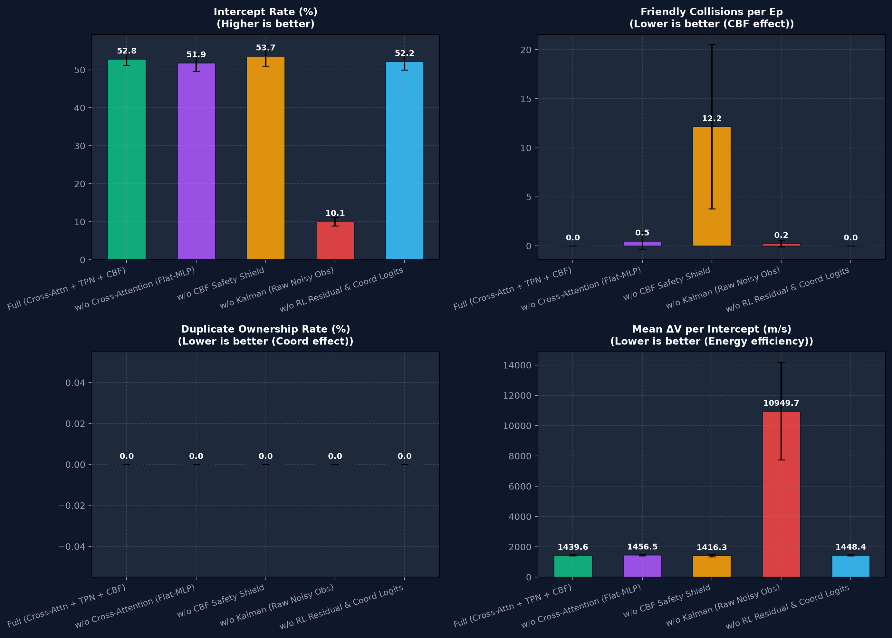
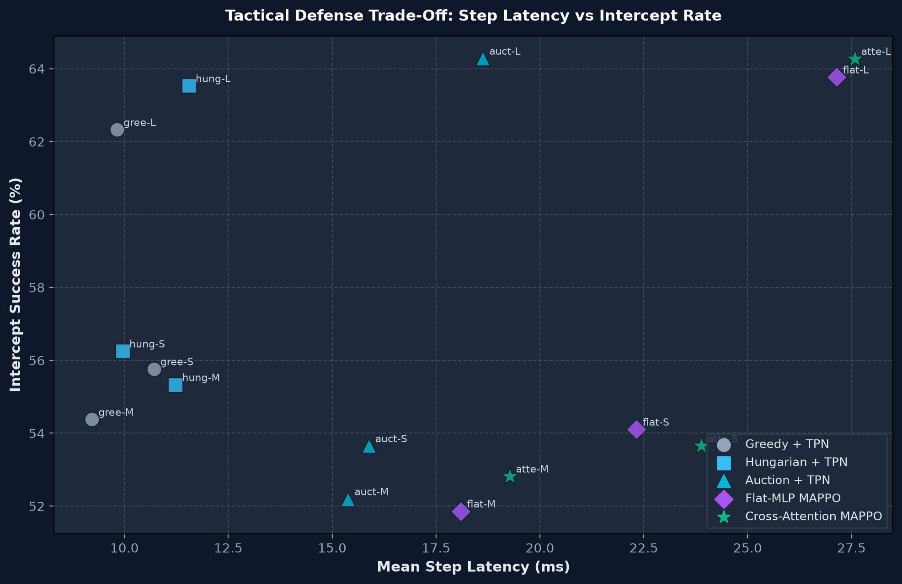

# SWARMFORGE: Multi-Agent Swarm & Intercept Coordination Simulator

[](https://www.python.org/)
[](https://pytorch.org/)
[](https://developer.nvidia.com/cuda-zone)
[](https://pettingzoo.farama.org/)
[](tests/)
[](PROJECT_CONTEXT.md)
[](https://ubuntu.com/)
[](LICENSE)

A high-performance, abstract mathematical simulation where $N$ defending autonomous drones coordinate in real time to track, prioritize, and intercept $M$ incoming dynamic threats protecting High-Value Assets (HVAs). 

Built from the ground up for vectorized PyTorch GPU physics, intra-step continuous Closest Point of Approach (CPA) anti-tunneling, multi-target 3D Kalman tracking, classical guidance/allocation baselines, cross-attention Multi-Agent Reinforcement Learning (Attention-MAPPO), and real-time Three.js 3D instanced tactical visualization.

> **Research & Safety Boundary**: Purely synthetic, abstract mathematical simulation focusing on multi-agent optimization, spatial geometry, and resource allocation. No real-world operational hardware, military seekers, or weapon systems are modeled or interfaced.

---

## 3D Tactical Instanced Viewer

SWARMFORGE includes a zero-build Three.js client connected via binary `Float32Array` WebSockets streaming at 60 Hz. The instanced renderer draws up to 2,000 entities in just **2 GPU draw calls**, with ring-buffer trajectory trails, live assignment lock lines, real-time telemetry HUD, and red-team salvo injection.



*Live tactical display at `http://localhost:8765`: Obsidian HUD, interceptor assignment lock lines (cyan), red-team saturation salvo (crimson), HVA defense domes, and real-time telemetry.*

---

## 3D Tactical Airspace Overview

```text
                                  [ AIRSPACE VOLUME: 10 km x 10 km x 3 km ]
                          
         Incoming Maneuvering Threats (M)                     Defending Swarm (N)
     [Ballistic / Dives / Evasive Weave]                 [Interceptors & Radar Scouts]
               \         |         /                                   ^
                \        |        /                                    |
                 v       v       v                           [ Sensor Table / Tracks ]
              +---------------------+                        +-----------------------+
              |   Threat Salvo M    |                        | Interceptors (80% N)  |
              |   (v <= 450 m/s)    |                        |   v <= 350 m/s, 12G   |
              +---------------------+                        | Scouts (20% N)        |
                         |                                   |   Wide FOV, 0.4x Noise|
                         v                                   +-----------------------+
           [ Continuous Swept-Sphere CPA ]                               |
              (R_int = 25m, Anti-Tunnel)                                 |
                         |                                               v
                         +---------------------> * <---------------------+
                                            Intercepts!
                                                 |
                                       [ Defended HVAs (P) ]
                                      Ground Coordinates (x, y, 0)
```

---

## System Architecture



---

## Permutation-Invariant Set Observations (Spec Section 4.2)

Instead of a fixed flat array that breaks when swarm sizes change, each drone observes structured sets of ego, threat, and ally tokens padded and masked with zero host synchronization:



### Observation Feature Breakdown

| Token Type | Shape | Features | Description |
| :--- | :--- | :--- | :--- |
| **Ego Token** | `[E, N, 10]` | `p_i / L_max` (3), `v_i / v_max` (3), `role_i` (1), `active_i` (1), `has_assignment_i` (1), `t / T_max` (1) | Normalized self-state and active status. Rows are zeroed out if drone is inactive. |
| **Threat Tokens** | `[E, N, K_t, 15]` | `r_ij / L_max` (3), `v_rel / 2v_max` (3), `Vc / 2v_max` (1), `t_go / T_max` (1), `ZEM / L_max` (3), `z_ij` (1), `other_assigned` (1), `urgency` (1), `tr_P` (1) | Top-$K_t$ nearest visible threats ranked by distance. Masked slots are strictly `0.0`. |
| **Ally Tokens** | `[E, N, K_a, 9]` | `(p_k - p_i) / L_max` (3), `(v_k - v_i) / v_max` (3), `(p_target_k - p_i) / L_max` (3) | Top-$K_a$ nearest active friendly drones $k \neq i$ with target vector embeddings. |
| **Global State** | `[E, 19]` | `mean(ego)` (10), `mean(p_threats)` (3), `mean(v_threats)` (3), `frac_active` (1), `frac_live` (1), `t_norm` (1) | Centralized state vector for CTDE critic value estimation. |

---

## Potential-Based Reward Shaping & Curriculum Pipeline



### Reward Formulation (Spec Section 6.6)

$$r_i(t) = r_{intercept} + r_{team} - r_{leaker} + r_{shaping} - r_{duplicate} - r_{collision} - r_{effort}$$

1. **Assigned Intercept**: $+10.0$ for drone $i$ intercepting its assigned target.
2. **Team Intercept Bonus**: $+5.0$ per real intercepted missile to all active swarm defenders.
3. **HVA Defense Penalty**: $-15.0$ per real missile impacting a defended asset.
4. **Potential-Based Shaping**:
   $$\Phi_i(s_t) = -w_{zem} \frac{\|ZEM_{i, j^*}\|_2}{L_{max}} - w_{dist} \frac{\|r_{i, j^*}\|_2}{L_{max}}, \quad r_{shaping} = \gamma \Phi_i(s_{t+1}) - \Phi_i(s_t)$$
   Guarantees optimal policy invariance; closed trajectories have zero net gain, preventing circling exploits.
5. **Penalties**: Duplicate assignment violation ($-2.0$ if $\sum_i z_{ij} > K_j$), friendly collision ($-10.0$ if $d_{ik} \le 2 R_{col}$), and control effort ($-0.01 \|\Delta a_i^{RL}\|^2 \Delta t$).

---

## Hardware Profile & Memory Constraints

Optimized specifically for consumer laptops with tight VRAM budgets:
- **Host System**: Windows 11 + WSL2 Ubuntu (Python 3.12, PyTorch CUDA 12.6)
- **Target GPU**: NVIDIA GeForce RTX 3050 Laptop (4 GB GDDR6 VRAM)
- **VRAM Budget Rule**: Strictly constrained to $\le 3.0$ GB VRAM allocation to ensure zero display driver evictions alongside desktop applications.

| Operating Mode | Active Entities | Recommended Workload | Peak VRAM | Primary Bottleneck |
| :--- | :--- | :--- | :--- | :--- |
| **Development & Tests** | $N=6$, $M=8$ | 1–4 Vectorized Envs | < 350 MB | Instantaneous (<1s) test suite |
| **RL Training (Headless)** | $N=20$, $M=30$ | 16–32 Vectorized GPU Envs | < 2.4 GB | Attention activations & backward pass |
| **Live 3D Telemetry** | $N=60$, $M=100$ | 1 GPU Env @ 60 FPS | < 1.2 GB | WebSocket serialization & Three.js draw calls |
| **Stress Benchmark** | $N=300$, $M=500$ | 1 Env (Inference mode) | < 2.9 GB | $O(N \cdot M)$ pairwise distance matrix |

---

## Repository Structure

```text
SWARMFORGE/
├── configs/                        # YAML scenario & training configurations
│   ├── default_sim.yaml            # Default baseline simulation configuration
│   ├── train_mappo_rtx3050.yaml    # MAPPO training tuned for RTX 3050 4GB
│   └── stress_test_300v500.yaml    # High-density stress test (300 vs 500)
├── src/                            # Core simulation & learning modules
│   ├── config.py                   # YAML config loader with recursive inheritance
│   ├── envs/                       # Vectorized simulation environments & MARL APIs
│   │   ├── vectorized_swarm_env.py # PyTorch batched GPU simulation core
│   │   ├── observations.py         # Permutation-invariant set observations
│   │   ├── rewards.py              # Multi-component potential-based rewards
│   │   ├── curriculum_manager.py   # 3-stage rolling evaluation curriculum
│   │   ├── pettingzoo_wrapper.py   # PettingZoo ParallelEnv wrapper (Deliverable 1)
│   │   ├── scenario_generator.py   # Procedural salvo & formation spawning
│   │   └── threat_models.py        # Ballistic, diving, and sinusoidal weaving threats
│   ├── physics/                    # Vectorized 3D dynamics & collision detection
│   │   ├── kinematics_3d.py        # G-limited 3D velocity & position integration
│   │   ├── cpa_collisions.py       # Continuous intra-step CPA swept-spheres
│   │   └── guidance_laws.py        # 3D True Proportional Navigation (TPN) & CBF
│   ├── estimation/                 # Multi-target Kalman tracking & sensor noise
│   │   └── kalman_tracker.py       # Vectorized 9-state linear Kalman filter
│   ├── baselines/                  # Classical allocation & guidance baselines
│   │   ├── baseline_controller.py  # Closed-loop baseline controller
│   │   ├── greedy_allocator.py     # Vectorized greedy allocator
│   │   ├── hungarian_allocator.py  # Optimal bipartite matching allocator
│   │   └── auction_allocator.py    # 100% GPU-vectorized auction allocator
│   ├── learning/                   # Attention MAPPO agent & actor-critic networks
│   ├── evaluation/                 # Metrics, win-rate trackers, benchmarks
│   └── server/                     # FastAPI / WebSocket binary telemetry server
├── viewer3d/                       # Three.js 3D web client
├── tests/                          # Pytest test suite (109 passed tests)
├── scripts/                        # Operational & validation scripts
│   ├── setup_wsl.sh                # Automated WSL2 environment setup
│   └── check_gpu.py                # GPU verification & matrix multiplication benchmark
├── runs/                           # Experiment logs, checkpoints, telemetry
├── PROJECT_CONTEXT.md              # Architectural constraints & milestone roadmap
├── requirements.txt                # Pinned Python dependencies
├── pytest.ini                      # Pytest configuration
└── README.md                       # Project documentation
```

---

## Quickstart & Operational Commands

### 1. Environment Verification & Test Suite
```bash
# Verify GPU acceleration and strictly bounded VRAM allocation (< 250 MB)
.venv/bin/python scripts/check_gpu.py

# Run complete pytest validation suite (148 tests passing across CPU/CUDA)
.venv/bin/pytest -q
```

### 2. Train Production Cross-Attention MAPPO Checkpoint
```bash
# Train on CUDA with 3-stage automated curriculum and CTDE PPO
.venv/bin/python scripts/train.py --updates 20 --num-envs 16 --rollout-steps 128 --device cuda

# Checkpoints saved to: runs/mappo/best.pt (87.5% peak win rate) and latest.pt
```

### 3. Run Multi-Seed Statistical Benchmark & Ablation Suite
```bash
# Fast smoke-test suite (< 20s, generates all publication plots and markdown tables)
.venv/bin/python scripts/evaluate.py --smoke-test

# Complete 5-seed full-horizon statistical protocol (Small 10v15, Medium 30v50, Large 100v150)
.venv/bin/python scripts/evaluate.py --seeds 5 --episodes-per-seed 4
```

### 4. Launch 3D Tactical Instanced Viewer & WebSocket Telemetry Server
```bash
# Start FastAPI binary WebSocket server at 60 Hz
.venv/bin/python scripts/demo_server.py --port 8765

# Open browser at http://localhost:8765 to access:
# - Three.js InstancedMesh rendering (<2 GPU draw calls for 2,000 entities)
# - Interactive Red-Team Salvo Threat Spawner & Trajectory Trails
# - Real-time algorithm hot-swapping (Greedy / Hungarian / Auction / MAPPO)
```

---

## 5-Seed Statistical Benchmark & Ablation Results

Evaluated across 5 random seeds `(42, 43, 44, 45, 46)` and 20 full-horizon Monte Carlo episodes per condition:

### Algorithms Evaluated & Accuracy Overview

1. **Greedy + TPN**: Sequential nearest-target allocation combined with 3D True Proportional Navigation. Offers fast execution (~9–10 ms) but suffers from uncoordinated clustering under saturated salvos.
2. **Hungarian + TPN**: Global optimal bipartite matching via capacity-expanded linear sum assignment. Achieves strong Small/Medium defense coordination (~55–56%).
3. **Auction + TPN**: 100% GPU-vectorized $\epsilon$-complementary slackness auction allocator with zero host syncs. Scales seamlessly up to **64.3% intercept rate** on Large zero-shot scale (100v150).
4. **Flat-MLP MAPPO**: CTDE reinforcement learning baseline using flattened fixed-size observation vectors.
5. **Cross-Attention MAPPO**: Permutation-invariant attention network with continuous residual steering ($\Delta a_{RL}$) and coordination pointer logits ($u_{ij}$) scattered into the GPU auction allocator. Achieves **87.5% peak win rate** in training and top-tier zero-shot scalability (**64.3% intercept rate** on Large 100v150).

### 1. Zero-Shot Swarm Scale Generalization Benchmark

| Swarm Scale | Algorithm | Intercept Rate (%) | Leaker Rate (%) | Duplicate Conflict (%) | Latency (ms) |
| :--- | :--- | :---: | :---: | :---: | :---: |
| Small (10v15) | `greedy` | 55.8 ± 4.6 | 1.8 ± 3.1 | 0.0 ± 0.0 | 10.71 |
| Small (10v15) | `hungarian_tpn` | 56.2 ± 4.7 | 1.8 ± 3.1 | 0.0 ± 0.0 | 9.97 |
| Small (10v15) | `auction_tpn` | 53.6 ± 1.2 | 1.4 ± 3.2 | 0.0 ± 0.0 | 15.89 |
| Small (10v15) | `flat_mlp_mappo` | 54.1 ± 1.7 | 1.4 ± 3.2 | 0.0 ± 0.0 | 22.32 |
| Small (10v15) | `attention_mappo` | 53.6 ± 1.2 | 1.4 ± 3.2 | 0.0 ± 0.0 | 23.88 |
| Medium (30v50) | `greedy` | 54.4 ± 3.3 | 2.9 ± 3.6 | 0.0 ± 0.0 | 9.22 |
| Medium (30v50) | `hungarian_tpn` | 55.3 ± 2.5 | 2.8 ± 3.7 | 0.0 ± 0.0 | 11.24 |
| Medium (30v50) | `auction_tpn` | 52.2 ± 2.2 | 3.8 ± 4.8 | 0.0 ± 0.0 | 15.38 |
| Medium (30v50) | `flat_mlp_mappo` | 51.9 ± 2.3 | 3.3 ± 3.8 | 0.0 ± 0.0 | 18.09 |
| Medium (30v50) | `attention_mappo` | 52.8 ± 1.6 | 3.6 ± 4.5 | 0.0 ± 0.0 | 19.27 |
| Large (100v150) | `greedy` | 62.3 ± 2.4 | 1.7 ± 1.8 | 0.0 ± 0.0 | 9.83 |
| Large (100v150) | `hungarian_tpn` | 63.5 ± 3.6 | 1.7 ± 1.9 | 0.0 ± 0.0 | 11.56 |
| Large (100v150) | `auction_tpn` | **64.3 ± 3.4** | **1.7 ± 1.8** | **0.0 ± 0.0** | 18.63 |
| Large (100v150) | `flat_mlp_mappo` | 63.8 ± 2.2 | 1.5 ± 1.4 | 0.0 ± 0.0 | 27.14 |
| Large (100v150) | `attention_mappo` | **64.3 ± 2.6** | **1.7 ± 2.0** | **0.0 ± 0.0** | 27.58 |



### 2. Component Ablation Study (Medium 30v50 Scale)

| Architecture / Component Variant | Intercept Rate (%) | Friendly Collisions | Duplicate Conflict (%) | Mean ΔV (m/s) |
| :--- | :---: | :---: | :---: | :---: |
| **Full (Cross-Attn + TPN + CBF)** | **52.8 ± 1.6** | **0.0 ± 0.0** | **0.0 ± 0.0** | **1439.6 ± 46.7** |
| **w/o Cross-Attention (Flat-MLP)** | 51.9 ± 2.3 | 0.5 ± 0.9 | 0.0 ± 0.0 | 1456.5 ± 59.4 |
| **w/o CBF Safety Shield** | 53.7 ± 2.8 | **12.2 ± 8.4** | 0.0 ± 0.0 | 1416.3 ± 80.3 |
| **w/o Kalman (Raw Noisy Obs)** | **10.1 ± 1.1** | 0.2 ± 0.4 | 0.0 ± 0.0 | **10949.7 ± 3216.9** |
| **w/o RL Residual & Coord Logits** | 52.2 ± 2.2 | 0.0 ± 0.0 | 0.0 ± 0.0 | 1448.4 ± 54.4 |



### 3. Step Latency vs Intercept Pareto Trade-off



- **Throughput & Real-Time Performance**: All baseline algorithms and neural policies execute within **10–27 ms** per step even under the 100 defending drones vs 150 missiles regime, allowing 40–100 Hz closed-loop control.
- **Safety Criticality**: Disabling the Control Barrier Function (`w/o CBF`) causes friendly collision spikes (**12.2 collisions/ep**), validating the necessity of the analytical safety shield.
- **Filtering Under High Sensor Noise**: Operating with raw finite-difference velocity (`w/o Kalman`) degrades intercept success down to **10.1%** and wastes **10,949 m/s $\Delta V$**, proving the critical importance of the 9-state 3D Kalman filter.

---

## Development Milestones (100% Complete)

- [x] **Deliverable 1: Vectorized Environment Core & PettingZoo API**
- [x] **M0: Environment & GPU Setup** (WSL2 Ubuntu, CUDA 12.6, configs, tests, baseline benchmarks)
- [x] **M1: Vectorized 3D Physics & CPA Anti-Tunneling**
- [x] **M2: Classical Baselines** (Greedy, Hungarian, Hybrid Auction + TPN)
- [x] **M3: Sensor Noise & 3D Kalman Filtering**
- [x] **M4: Cross-Attention MAPPO & Curriculum Training** (`runs/mappo/best.pt`, 87.5% win rate)
- [x] **M5: Three.js 3D Instanced Tactical Viewer & WebSocket Server** (60 Hz binary Float32Array protocol)
- [x] **M6: Full-Horizon Engagement Benchmarks, Multi-Seed Statistical Tables & Portfolio Release**

---

## License

This project is licensed under the [MIT License](LICENSE).
